


  

**I build software that moves money and information more safely, and automation that runs without me.** 
Founder & Group CEO, Nebula-Q Protocol · DeFi protocol design, smart contract auditing, cross-chain infrastructure · Chief International Adviser for Youth Innovation, Edo State

 

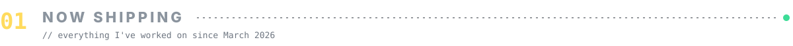

  <a href="https://github.com/RolandDivine/gabriel"></a>
  <a href="https://github.com/RolandDivine/autopilot"></a>
  
  
  <a href="https://github.com/RolandDivine/The-EYE-"></a>

🔒 Private repositories are in active development. Ask me for a walkthrough.

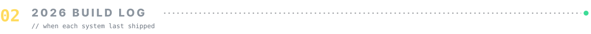

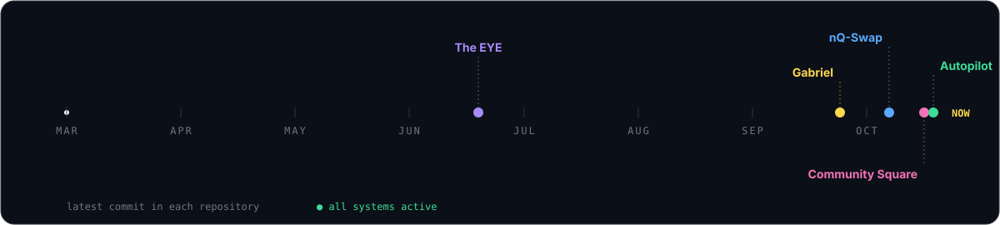

 

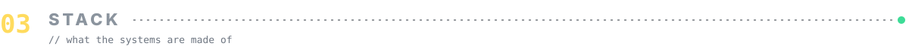

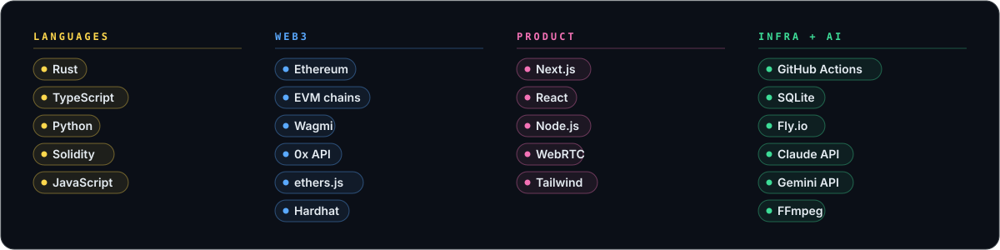

 

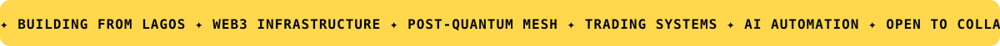
